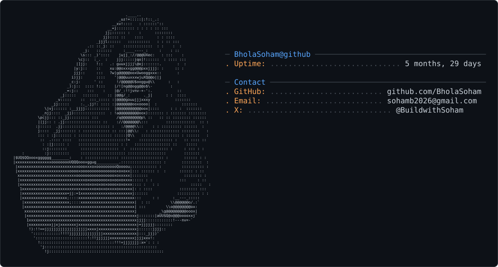
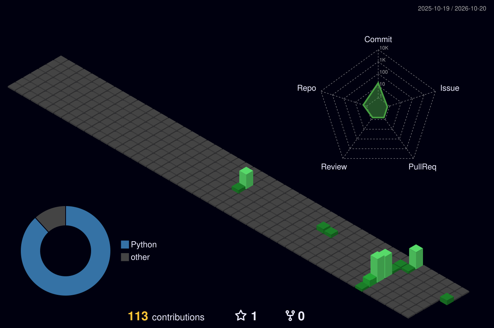

  

  

  
  

---

## 👨‍💻 About Me

## ⚙️ Tech Stack

  <strong>Languages</strong> 
  
  
  
  

  <strong>Frontend</strong> 
  
  
  
  

  <strong>Backend, Data & Tools</strong> 
  
  
  
  
  
  
  

## 🚀 Featured Project

### ✈️ Airport Management System — *Heath*

A Python + MySQL airport operations system with an NLP-powered chatbot interface.

- Modular CRUD workflows for passengers, flights, check-in, and security.
- spaCy-based intent recognition and input validation.
- Structured database output for easier debugging and more consistent records.

**Stack:** Python · MySQL · spaCy · Git

## 📊 GitHub Activity

  

  

## 🧊 Contributions in 3D

  

---

<b>Thanks for stopping by — let's build something useful. ✨</b>

